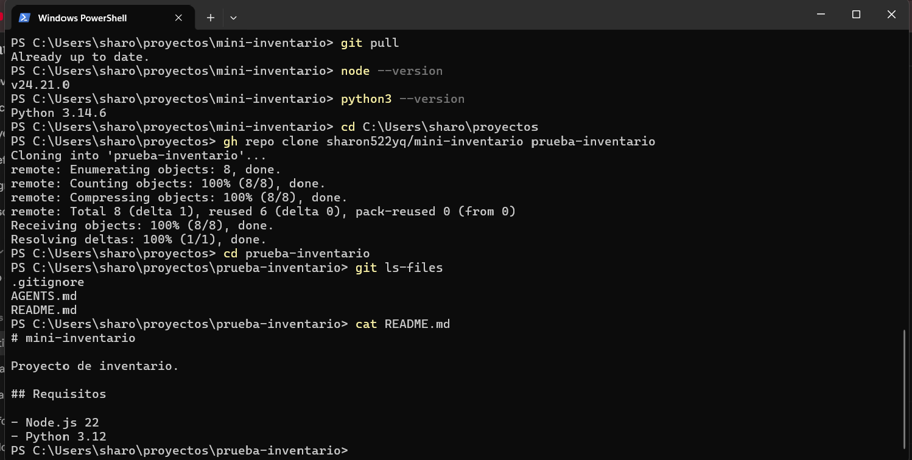

# Bitácora — Día 1: repositorio y entorno de trabajo

**Agente utilizado:** Codex (CLI) · **Terminal:** PowerShell 7.7.0 · **Repositorio:** https://github.com/sharon522yq/mini-inventario

## Prompts clave

1. Creación del repositorio:
   > Crea en esta carpeta un repositorio Git llamado mini-inventario. Usa gh para publicarlo como repositorio público en mi cuenta. Agrega un README corto que indique que el proyecto requiere Node.js 22 y Python 3.12, y un .gitignore para Node y Python que excluya .env, .venv y node_modules. Antes de ejecutar cada comando, explícame qué hace.

2. Reglas del proyecto:
   > Crea el archivo de instrucciones de este proyecto (CLAUDE.md si eres Claude Code, AGENTS.md si eres Codex). Explica que Mini Inventario es una web de inventario, que el proyecto usa Node.js 22 y Python 3.12, que cada cambio va en una rama con pull request, que nunca se suben llaves ni archivos .env, y que debes pedir aprobación antes de borrar datos o desplegar. Máximo 20 líneas.

## Error o mala decisión de la IA

Codex creó el README y el .gitignore, pero no pudo hacer el commit ni publicar. Concluyó que mi token de `gh` era inválido y que había que repetir `gh auth login`.

**Cómo lo detecté:** ejecuté `gh auth status` en otra terminal y la sesión estaba activa. El problema real era el sandbox de Codex: bloquea la escritura en `.git` y el acceso a la red y a las credenciales. Además, la carpeta `.git` quedó a nombre del usuario interno del sandbox (`CodexSandboxOffline`), y Git la rechazó con el error *dubious ownership*.

**Solución:** borré la carpeta `.git` (todavía no tenía commits), la volví a crear con `git init -b main` desde mi usuario, e hice el commit y la publicación yo misma con `gh repo create`.

## Comandos que aprobé o rechacé

- **Rechacé** la opción "Restart with these settings" del servidor en segundo plano de Codex. Cambiaba ajustes de forma permanente y podía desactivar funciones en otros clientes. Elegí "Run without daemon this time", que solo afecta esta sesión.
- **Rechacé** actualizar Codex (0.160.0 a 0.167.2) a mitad de la actividad, para no interrumpir el trabajo.
- **Aprobé** la creación del README, el .gitignore y el AGENTS.md, porque solo escriben archivos dentro de la carpeta del proyecto.

## Cómo comprobé que funciona

- `gh auth status`: sesión activa como sharon522yq.
- Versiones: Node v24.21.0 (cumple el mínimo de 22.20) y Python 3.14.6 (más nueva que la 3.12 del README; pendiente instalar la 3.12 para los días del servidor MCP).
- Agregué AGENTS.md mediante una rama y el pull request #1, siguiendo la regla del propio proyecto.
- Cloné el repositorio en una carpeta nueva (`prueba-inventario`). `git ls-files` muestra `.gitignore`, `AGENTS.md` y `README.md`, y el README indica Node.js 22 y Python 3.12.
   