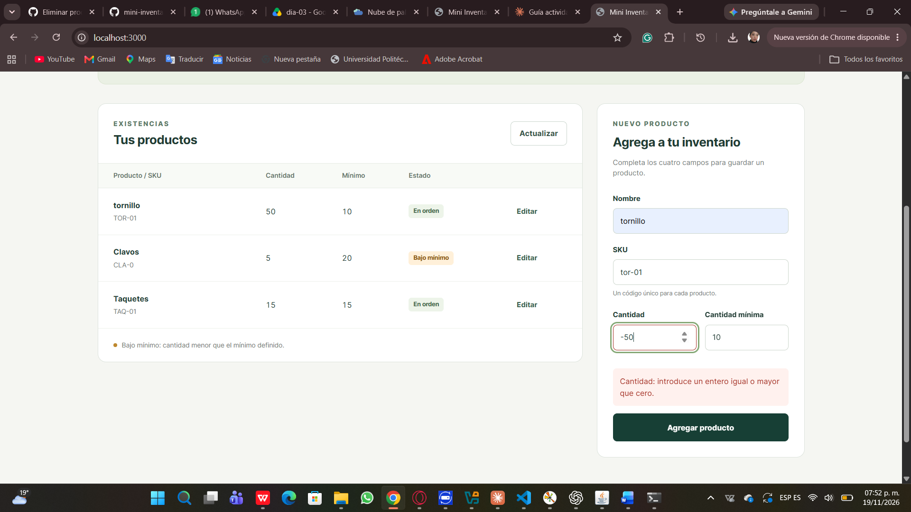
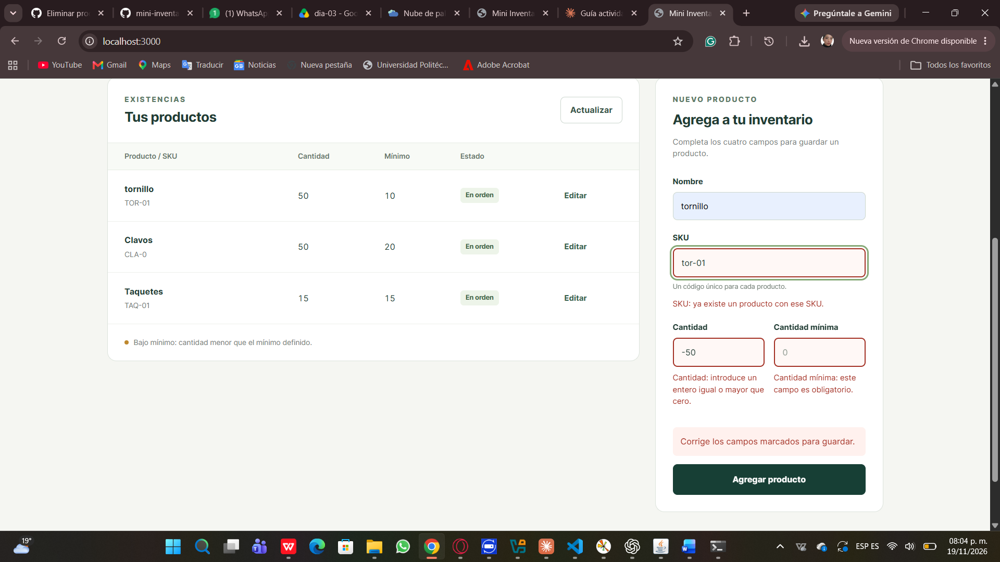

# Bitácora — Día 3: primera versión de la web

**Agente utilizado:** Codex (CLI), permisos "Ask for approval" · **Rama:** dia-03-web

## Prompts clave

1. Primera versión:
   > Lee docs/requisitos.md y docs/diseno.md. Construye la primera versión de Mini Inventario. Express sirve la carpeta public/, responde /health y usa process.env.PORT o el puerto 3000. La página lista, agrega y edita productos, y marca los que tienen una cantidad por debajo del mínimo. Todo el acceso a datos va en public/productos.js y por ahora usa localStorage, porque mañana lo cambiaremos por Supabase. No agregues inicio de sesión todavía. Explica tu plan antes de editar.

2. Corrección después de probar a mano:
   > Cuando varios campos tienen errores, solo se muestra uno. Por ejemplo, con SKU duplicado y cantidad negativa solo aparece el error de cantidad. Muestra los errores de todos los campos a la vez y resalta cada campo con problema. No uses git.

3. Revisión acotada después de compactar:
   > Revisa solo public/productos.js y dime si algo no cumple docs/diseno.md. No edites nada todavía.

## Error o mala decisión de la IA

Pedí que explicara el plan antes de editar, pero Codex siguió trabajando sin esperar mi aprobación y creó su propia rama `feat/primera-version` en lugar de `dia-03-web`.

**Cómo lo detecté:** en la salida vi el comando `git switch -c feat/primera-version`. Lo detuve con Esc, le pedí que no usara git, cambié a mi rama con `git switch -C dia-03-web` y borré la suya con `git branch -D feat/primera-version`.

## Comandos que aprobé o rechacé

- **Rechacé** que Codex ejecutara `npm install` fuera del sandbox. El comando no muestra qué va a instalar, así que primero revisé `package.json` para confirmar que la única dependencia era `express`, y luego lo ejecuté yo.
- **Mantuve** el permiso "Ask for approval" para que Codex pidiera autorización antes de usar internet.
- Hice yo misma el commit y el push, siguiendo la regla de `AGENTS.md`.

## Pruebas a mano y correcciones

| Prueba | Resultado |
|---|---|
| Agregar 3 productos | Aparecen en la lista |
| Clavos con 5 de mínimo 20 | Marcado "Bajo mínimo" |
| Taquetes con 15 de mínimo 15 | No se marca (igual al mínimo, como dice el requisito) |
| Recargar la página | Los productos se conservan |
| Guardar con campos vacíos | No guarda y el mensaje nombra el campo |
| SKU ` tor-01 ` repetido | Rechazado por duplicado |
| Cantidad `-50` | Rechazada |
| Editar cantidad | La marca se actualiza |

**Corrección 1 (mía):** con SKU duplicado y cantidad negativa solo aparecía un error. Pedí mostrar todos a la vez y resaltar los campos.

**Corrección 2 (revisión acotada):** Codex encontró 3 diferencias con el diseño. Corregí dos: limitar las cantidades al máximo de `integer` de PostgreSQL (2147483647) y guardar `created_at` para ordenar por creación. Descarté la de concurrencia entre pestañas, porque solo aplica a localStorage, que mañana se reemplaza por Supabase.

## Contexto

| Momento | Contexto usado | Disponible |
|---|---|---|
| Antes de `/compact` | 64.1K de 475K tokens | 89% |
| Después de `/compact` | 12.7K de 475K tokens | 100% |

**Qué cambió en la respuesta:** después de compactar, Codex volvió a leer `docs/diseno.md` y `public/productos.js` porque el resumen ya no los tenía completos. La respuesta fue más enfocada: revisó un solo archivo, citó números de línea exactos y encontró 3 diferencias que no habían salido antes.

## Cómo comprobé que funciona

- `npm test`: 12 pruebas pasaron.
- `/health` respondió `{"status":"ok"}` en el puerto 3000.
- `Select-String -Path public\*.js, server.js -Pattern "localStorage"` solo encontró líneas en `public\productos.js`.
- Probé a mano los 8 casos de la tabla y las correcciones.

