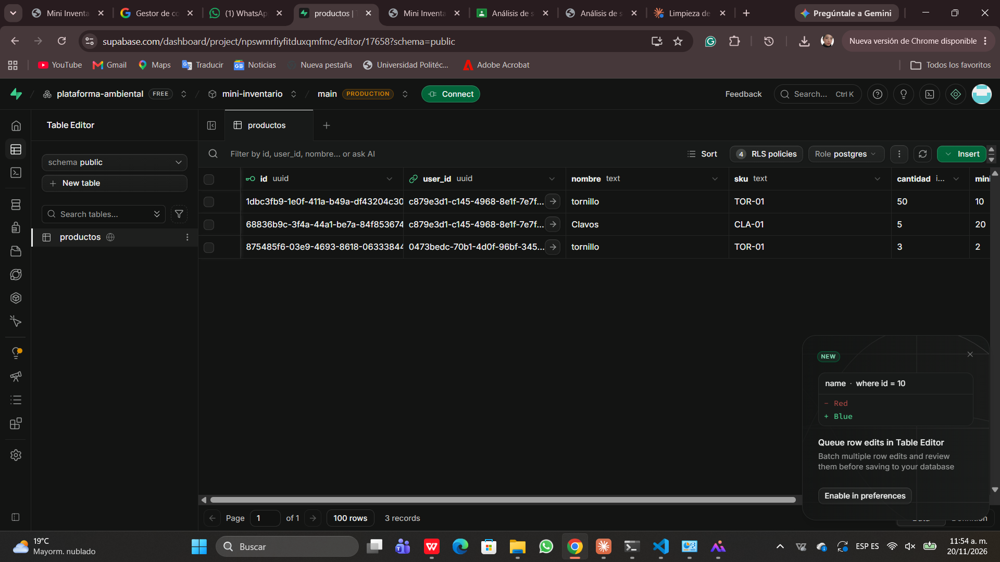
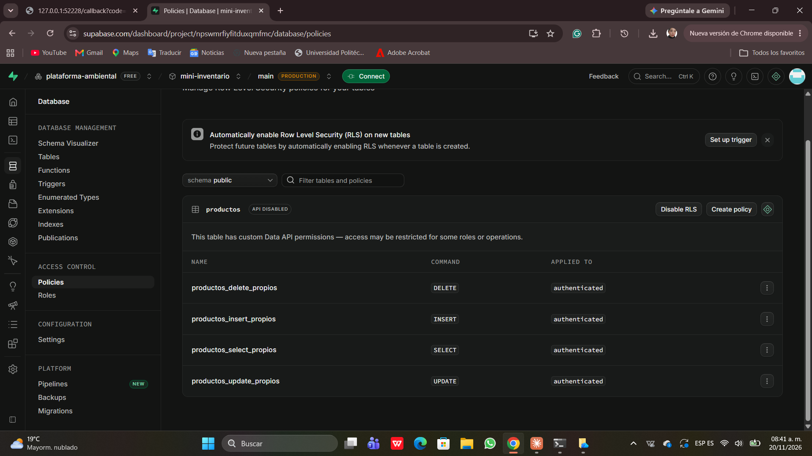
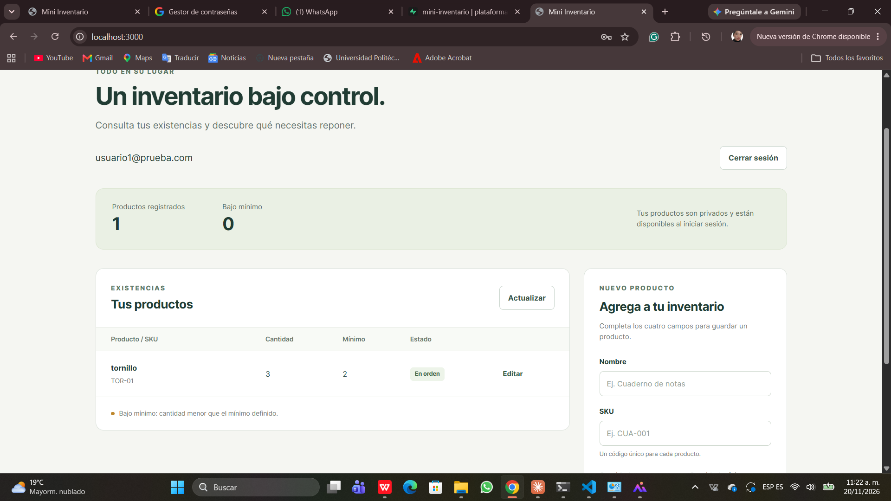
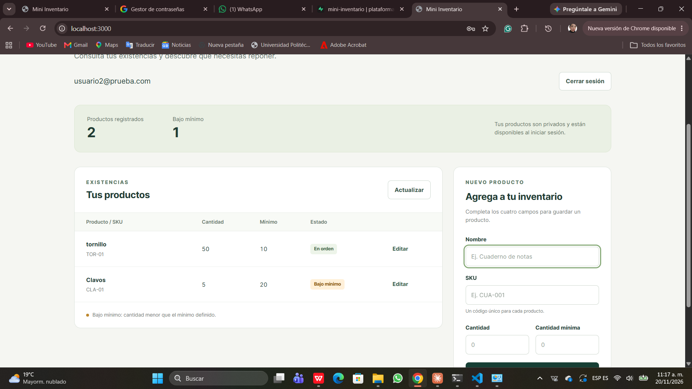

# Bitácora — Día 4: Supabase, inicio de sesión y RLS

**Agente:** Codex (CLI), permisos "Ask for approval" · **Rama:** dia-04-supabase

## Prompts clave

1. Tabla y políticas:
   > Usa el MCP de Supabase solo en este proyecto y sigue las skills supabase y supabase-postgres-best-practices. Crea una migración con la tabla productos según docs/diseno.md. Activa Row Level Security y crea políticas para que cada usuario solo pueda leer, crear, editar y borrar sus propios productos. Muéstrame el SQL antes de aplicarlo.

2. Conexión de la web:
   > Cambia public/productos.js para usar Supabase en lugar de localStorage. Agrega registro e inicio de sesión con correo y contraseña. Lee SUPABASE_URL y SUPABASE_KEY del archivo .env y entrégalas al navegador desde la ruta /config.js. Usa solo la llave publishable o anon, nunca la service_role. Crea un .env.example sin valores. Al guardar productos envía solo nombre, sku, cantidad y minimo. Explica tu plan antes de editar y no uses git.

## Uso del MCP

- Lo conecté con `codex mcp add supabase --url "https://mcp.supabase.com/mcp?project_ref=npswmrfiyfitduxqmfmc"`. El `project_ref` limita al agente a este proyecto.
- Mantuve la aprobación manual: aprobé `apply_migration` con "Allow" (solo esa vez) y no con "Always allow", porque el MCP actúa con mis permisos y puede modificar la base de datos.
- Instalé las skills `supabase` y `supabase-postgres-best-practices`.

### SQL que aprobé y qué hace

```sql
create policy productos_update_propios on public.productos
for update to authenticated
using ((select auth.uid()) = user_id)
with check ((select auth.uid()) = user_id);
```

`using` revisa que el producto que quiero editar sea mío, y `with check` revisa que después de editarlo siga siendo mío. Así nadie puede editar productos ajenos ni pasarle un producto a otro usuario. Además, la migración solo permite que la app escriba `nombre`, `sku`, `cantidad` y `minimo`; `id`, `user_id` y `created_at` los pone la base de datos.

La migración quedó guardada en `supabase/migrations/20261120143556_crear_productos_con_rls.sql`.

## Errores o malas decisiones de la IA

- Codex intentó crear la rama `feat/productos-rls` aunque yo ya estaba en `dia-04-supabase`. Lo rechacé y le pedí no usar git.
- Le pedí explicar el plan antes de editar la web, pero modificó `public/productos.js` sin esperar.

## Comandos que aprobé o rechacé

- **Rechacé** `git switch -c feat/productos-rls`, porque las ramas las manejo yo.
- **Aprobé** `npm install --save-exact @supabase/supabase-js`, porque es el cliente oficial y la única dependencia nueva.
- **Aprobé** `apply_migration` después de revisar el SQL completo: tabla con enteros no negativos, índice único del SKU por usuario, RLS activo y 4 políticas `to authenticated`.

## Cómo comprobé que funciona

- En Supabase: la tabla `productos` tiene RLS activo y 4 políticas (SELECT, INSERT, UPDATE, DELETE) para `authenticated`.
- `git check-ignore .env` respondió `.env`, y ningún archivo de la app usa `service_role`.
- El inicio de sesión fallaba con un mensaje genérico. Con F12 → Network vi `ERR_NAME_NOT_RESOLVED` y con `nslookup` confirmé que el dominio no existía. Al compararlo con el botón **Connect** de Supabase encontré que a la URL del `.env` le faltaba una letra del Project Ref. La corregí y ya pude entrar.
- Prueba de aislamiento: cada usuario ve solo sus productos, aunque los dos tienen un producto con el SKU `TOR-01`.




