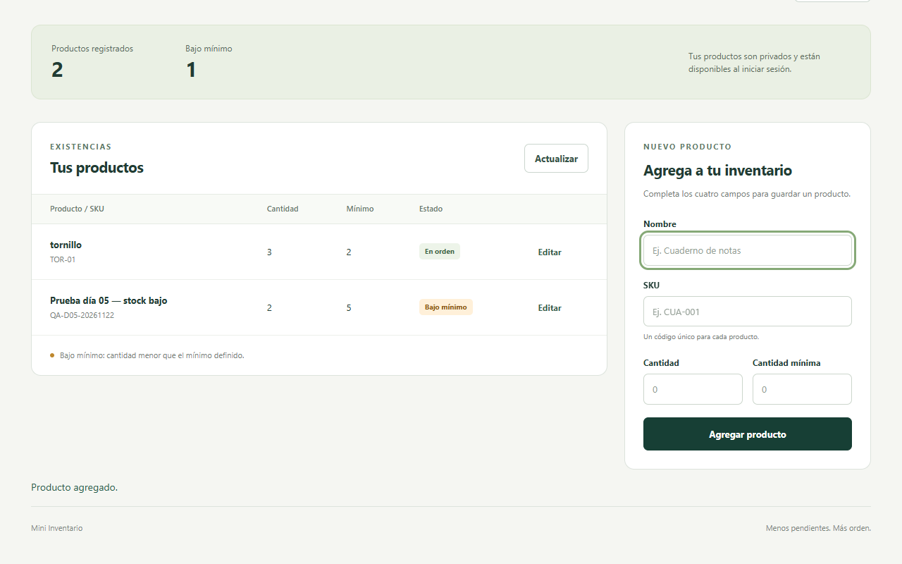
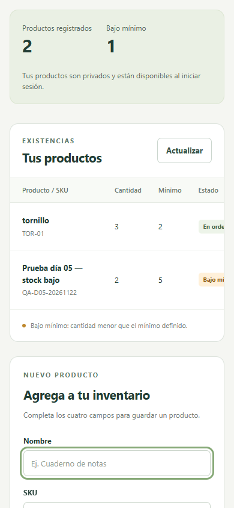
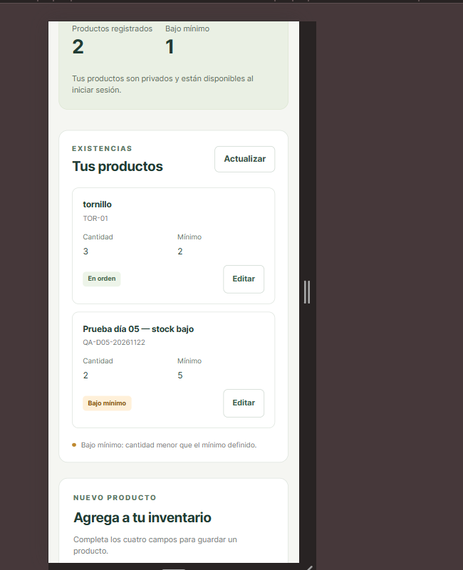
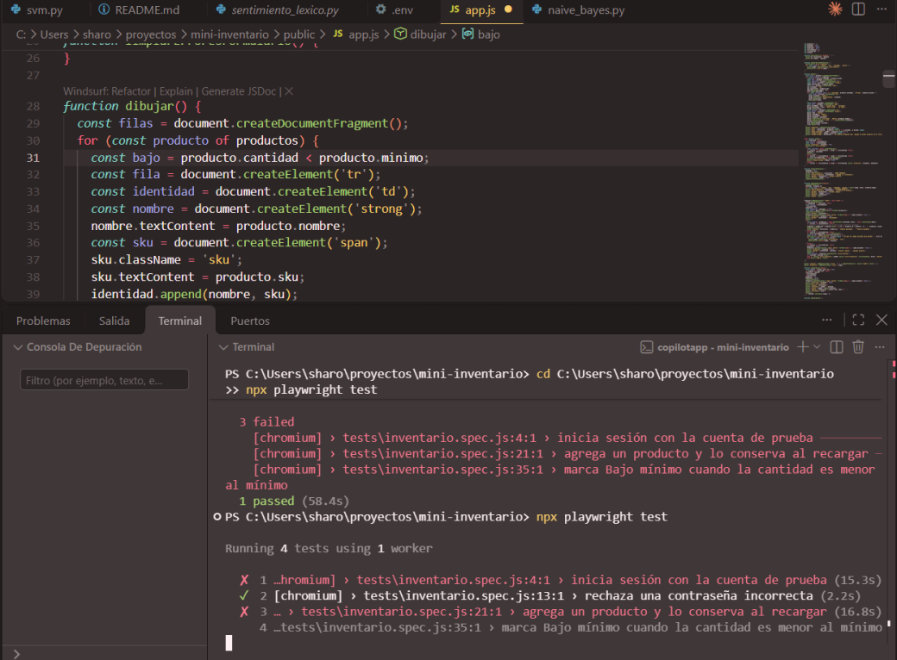
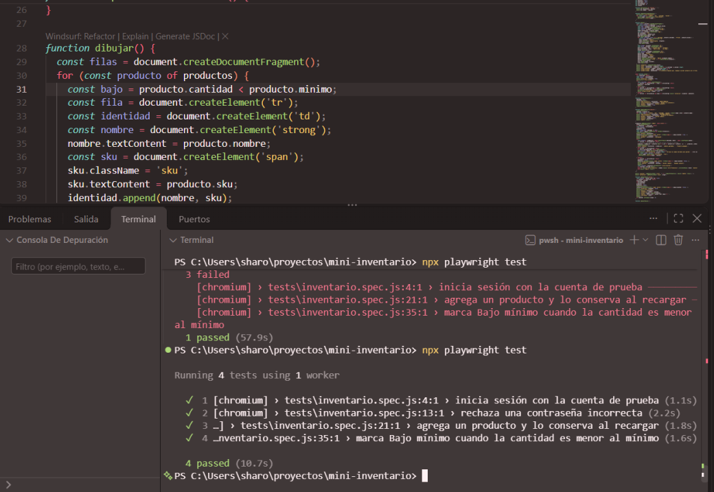

# Bitácora — Día 5: pruebas con Playwright

**Agente:** Codex (CLI) · **Rama:** dia-05-pruebas

## Prompts clave

1. Exploración:
   > Arranca la app. Usa playwright-cli para abrir http://localhost:3000, iniciar sesión con TEST_EMAIL y TEST_PASSWORD de .env sin mostrarlos, y agregar un producto con cantidad menor al mínimo. Toma capturas en 1280x800 y en 390x844, y revisa los errores de consola. Guarda las capturas en entregas/dia-05/ y reporta lo que encontraste. No corrijas nada todavía. No uses git.

2. Corrección:
   > Corrige el problema de la vista móvil: en 390x844 la tabla de productos se desborda, el estado se corta y el botón Editar queda fuera de la pantalla. Haz que en pantallas angostas cada producto se vea completo, sin cambiar la vista de escritorio.

3. Pruebas:
   > Escribe pruebas de Playwright en tests/ para: iniciar sesión, rechazar una contraseña incorrecta, agregar un producto y marcar un producto bajo el mínimo. Cada prueba usa un SKU único y borra lo que creó al terminar, aunque la prueba falle. Configura webServer para arrancar la app. Usa solo chromium.

## Exploración

- Capturas: `escritorio-1280x800.png` y `movil-390x844.png`. Reporte completo en `reporte.md`.
- Consola: 404 de `favicon.ico` (sin impacto) y un 400 al iniciar sesión, porque la contraseña tenía `#` y el `.env` lo tomaba como comentario. Lo corregí poniendo el valor entre comillas.

## Problema real y corrección

En móvil (390 px) la tabla medía 480 px: el estado se cortaba y el botón Editar quedaba fuera de la pantalla. Codex hizo que en pantallas angostas cada producto se muestre como tarjeta. Lo comprobé en la app real con la vista de dispositivo de Chrome (`movil-corregido-real.png`).

## Pruebas

4 pruebas en `tests/inventario.spec.js`. Cada una usa un SKU `E2E-` único y lo borra en un `finally`, aunque falle, con el mismo usuario de prueba y la llave publicable (sin `service_role`). Después de correrlas, la tabla en Supabase no tenía productos `E2E-`.

## Detección de errores

Cambié `producto.cantidad < producto.minimo` por `>` en `public/app.js`. Fallaron "agrega un producto" (esperaba "En orden" y recibió "Bajo mínimo") y "marca Bajo mínimo" (esperaba "Bajo mínimo" y recibió "En orden") (`pruebas-fallan.png`). Al regresar el `<` y guardar el archivo, pasaron las 4 (`pruebas-pasan.png`). Una segunda corrida falló porque olvidé guardar antes de correrla.

## Errores de la IA

- Guardó dos capturas de móvil con nombres distintos pero idénticas. Borré la repetida.
- Verificó la corrección móvil con datos simulados. La comprobé yo en la app real.
- El issue #6 "Eliminar productos" se cerró en el Día 3 sin que la función existiera.

## Comandos aprobados o rechazados

- **Aprobé** el script de inicio de sesión de playwright-cli porque leía las credenciales del `.env` en memoria y no las imprimía.
- **Aprobé** `npx playwright test`.

