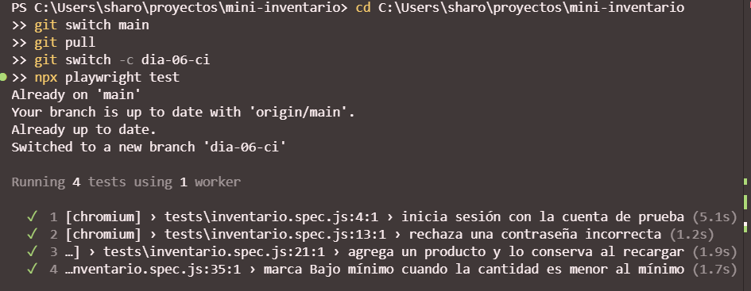
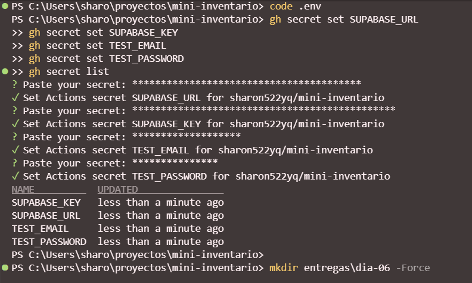
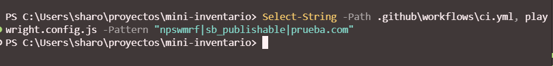
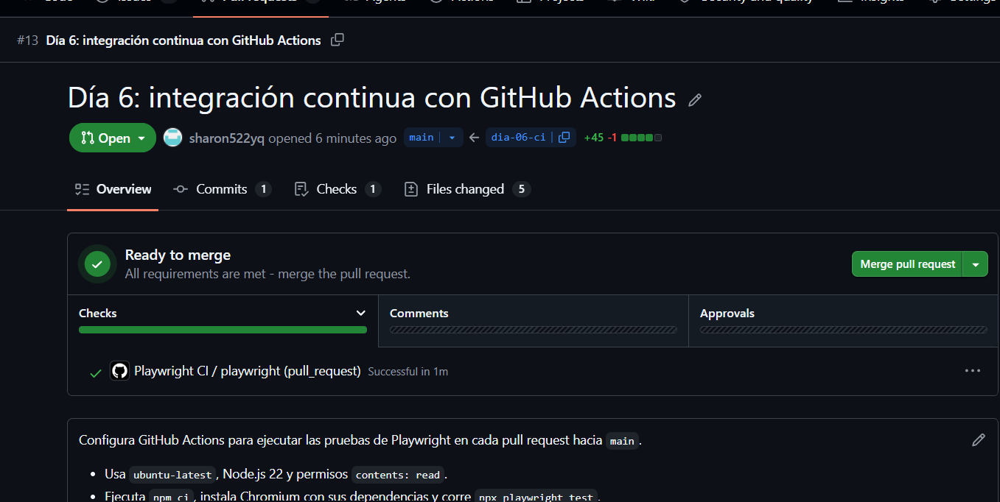
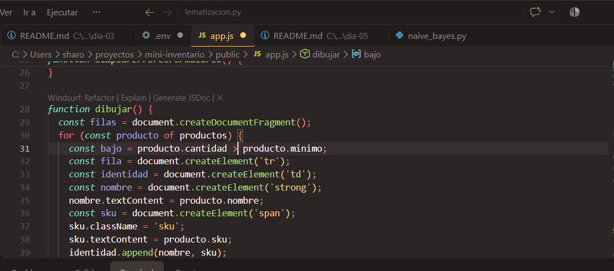
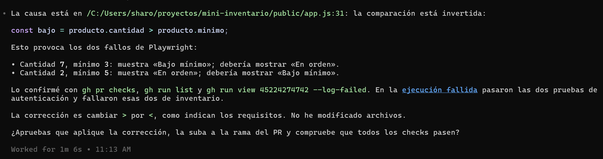
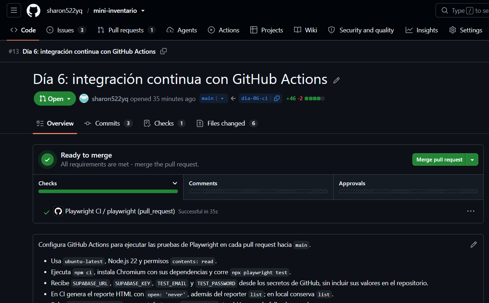

# Bitácora — Día 6: integración continua con GitHub Actions

**Agente:** Codex (CLI), permisos "Ask for approval" · **Rama:** dia-06-ci · **Pull request:** #13

## Prompts clave

1. Flujo de CI:
   > Crea .github/workflows/ci.yml para que en cada pull request hacia main se ejecute en ubuntu-latest con Node 22: npm ci, instalación de Chromium con sus dependencias (npx playwright install --with-deps chromium) y las pruebas de Playwright. Pasa como variables de entorno los secretos SUPABASE_URL, SUPABASE_KEY, TEST_EMAIL y TEST_PASSWORD con ${{ secrets.NOMBRE }}, sin escribir ningún valor. Usa permissions: contents: read. Sube la carpeta playwright-report como artefacto con if: always(), para que también se suba cuando fallen. En playwright.config.js, cuando exista la variable CI, usa además el reporter html con open: 'never'; en local deja el reporter list. No uses git ni abras el pull request todavía; muéstrame el archivo cuando termines.

2. Diagnóstico (en una conversación nueva, sin pistas):
   > Las verificaciones de este pull request fallaron. Usa gh pr checks, gh run list y gh run view con --log-failed para encontrar la causa. Explícamela antes de corregir. Cuando la apruebe, corrige, sube el cambio y comprueba que todo pase.

## Flujo de CI

`.github/workflows/ci.yml` se ejecuta con `on: pull_request` hacia `main` en `ubuntu-latest` con Node 22. Corre `npm ci`, instala Chromium con `npx playwright install --with-deps chromium` y ejecuta `npx playwright test`. Al final sube `playwright-report/` como artefacto con `if: always()`, para tener el reporte aunque las pruebas fallen.

Agregué al prompt de la guía el ajuste del reporter: `playwright.config.js` usaba solo el reporter `list`, que no genera la carpeta `playwright-report`, así que el artefacto habría salido vacío. Ahora en CI se usa además el reporter `html`.

## Secretos

- Los guardé yo con `gh secret set` desde mi terminal (`SUPABASE_URL`, `SUPABASE_KEY`, `TEST_EMAIL`, `TEST_PASSWORD`). No los escribí en el agente.
- La contraseña la guardé sin las comillas que uso en `.env` (ahí solo sirven para que el `#` no se tome como comentario).
- `gh secret list` muestra solo los nombres (`secretos.png`).
- Busqué los valores en el código y no aparecen (`sin-secretos.png`):
  `Select-String -Path .github\workflows\ci.yml, playwright.config.js -Pattern "npswmrf|sb_publishable|prueba.com"`
- `playwright.config.js` carga `.env` solo si existe; en GitHub toma las variables de los secretos.

## Verde, rojo y verde en el mismo pull request

1. **Verde:** al abrir el PR #13, Playwright CI pasó en 1 minuto (`ci-verde-1.png`).
2. **Rojo:** cambié `<` por `>` en `public/app.js` y lo subí con el mensaje neutral "Ajusta la lógica de la tabla de productos", para no darle pistas al agente. El check falló (`ci-rojo.png`).
3. **Verde:** Codex corrigió la línea, subió el commit `4f5f0db` y `gh pr checks --watch` confirmó que pasó (`ci-verde-2.png`).

## Diagnóstico y causa de la falla (con mis palabras)

Codex usó `gh pr checks`, `gh run list` y `gh run view 45224274742 --log-failed`, y señaló `public/app.js:31` antes de modificar nada (`diagnostico.png`).

La falla se debió a que invertí el signo de la comparación que decide si un producto está bajo el mínimo. Con `>`, la app marcaba al revés: un producto con 7 piezas y mínimo 3 aparecía como "Bajo mínimo", y uno con 2 piezas y mínimo 5 como "En orden". Las dos pruebas que revisan esa insignia fallaron en GitHub Actions. Las de inicio de sesión siguieron pasando, porque no dependen de esa línea. Al regresar el signo a `<`, las cuatro pasaron.

## Errores o malas decisiones de la IA

- Para validar el YAML, Codex intentó usar Python con un módulo (`yaml`) que no está instalado; el comando falló y tuvo que buscar otra forma.
- Al abrir el PR, guardó el texto en `.playwright-cli/pr-dia-06-ci.md`. Revisé que esa carpeta está en `.gitignore`, así que no se subió.

## Comandos aprobados o rechazados

- **Aprobé** `gh pr checks`, `gh run list` y `gh run view --log-failed`, porque solo leen el estado y los registros del flujo.
- **Aprobé** la corrección después de leer el diagnóstico, y comprobé que el commit solo cambió una línea de `public/app.js`.
- **Rechacé** las opciones de "no volver a preguntar" para mantener la aprobación manual.
- Abrí una conversación nueva (`/new`) antes del diagnóstico, para que el agente no supiera qué había cambiado.

## Cómo comprobé que funciona

- `npx playwright test` pasó en mi computadora antes de crear el flujo (`pruebas.png`).
- El mismo PR #13 pasó de verde a rojo y otra vez a verde.
- Revisé el commit de la corrección: 1 archivo, 1 línea.

